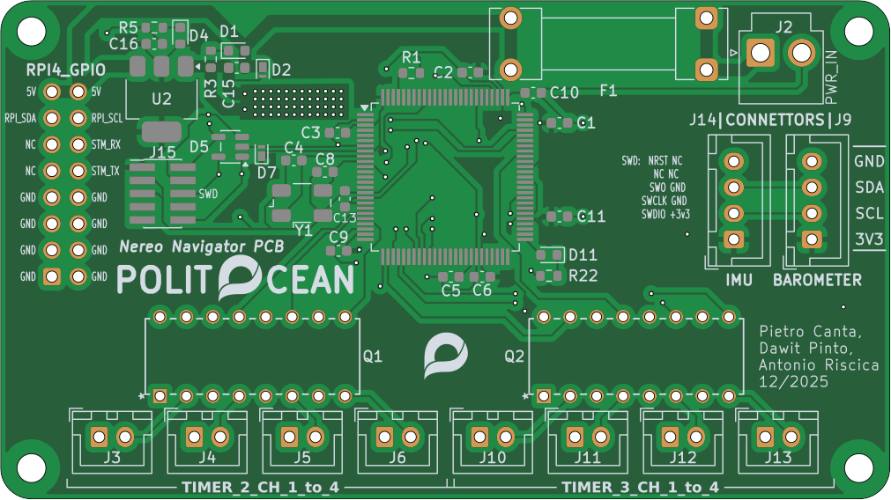
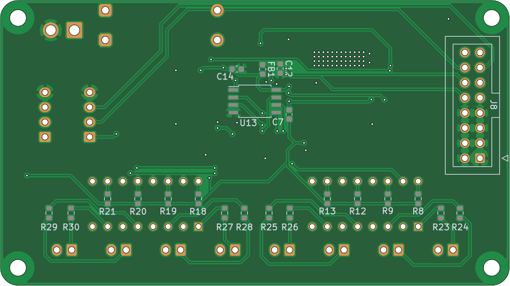
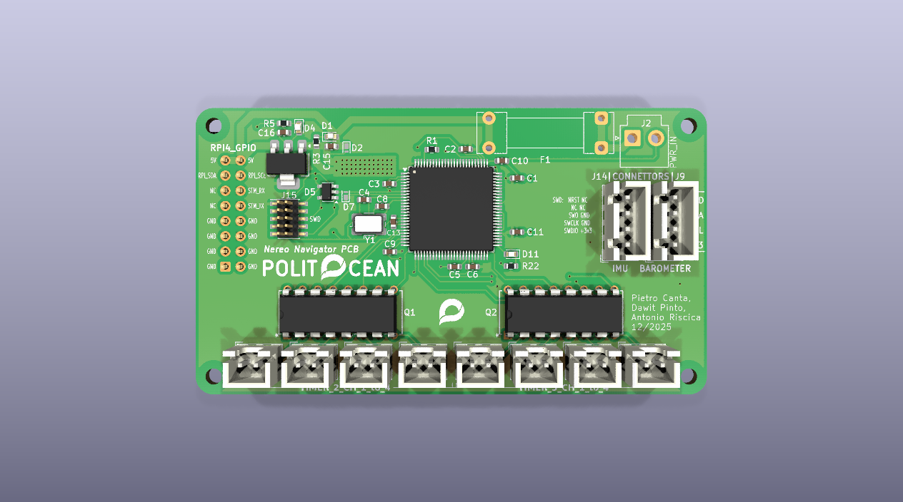

# nereo_FC_pcb

Flight controller di Nereo (STM32F4, 2 layer).
Firmware: [nereo_FC_firmware](https://github.com/PoliTOcean/nereo_FC_firmware)

| Top | Bottom |
|---|---|
|  |  |

> I file di produzione (gerber, BOM, PDF dello schema) si scaricano dalla scheda **Actions** → ultimo run → **pcb-outputs**.
